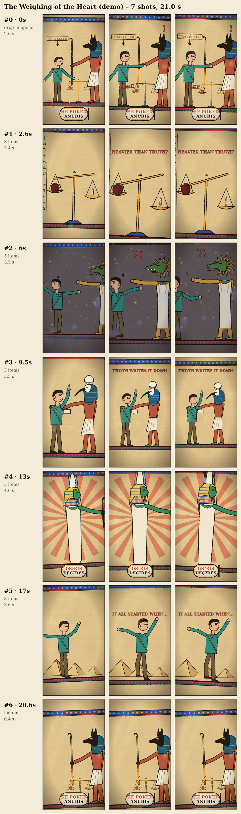

# SceneParts

**An open library of animated parts – characters, props, scenery, backgrounds, effects and scene templates – that anyone (and any Claude) can search, reuse and add to.**

Videos are written as one small JSON file. Parts draw every frame as SVG, in a consistent style, with camera moves, cuts and seamless loops. A part is drawn once, reviewed by a human, and then reused by everyone, so each new video costs a few searches and a few lines of JSON instead of thousands of lines of drawing code.

[Gallery](https://krakujs.github.io/sceneparts/) · [Make a video](skills/make-video/SKILL.md) · [Contribute a part](CONTRIBUTING.md) · [Governance](GOVERNANCE.md)



## With Claude

Install the plugin once.

- **Claude Code:** `claude plugin marketplace add krakujs/sceneparts` then `claude plugin install sceneparts@sceneparts`
- **Claude app / Cowork:** Customize → Plugins → add marketplace `krakujs/sceneparts` → install **SceneParts**

Then just ask: *"Make a 20-second Short about the weighing of the heart."* Claude searches the library, writes `story.json`, previews and renders. If it has to draw something new, it offers to contribute it back as a pull request from your GitHub account.

| Skill | What it does |
| --- | --- |
| `make-video` | Script → story.json → validate → preview → render |
| `find-and-use-parts` | Search, inspect and add parts instead of drawing them |
| `contribute-part` | Turn a newly drawn part into a reviewed pull request |
| `add-artifact` | Real museum photo (CC0 only) with its credit line |

## Without Claude

```bash
npx @sceneparts/cli init my-video && cd my-video && npm install
npx sceneparts styles
npx sceneparts search "jackal god" --style egypt-tomb
npx sceneparts add egypt-tomb/anubis egypt-tomb/scale
npx sceneparts validate story.json && npx sceneparts preview story.json
npx sceneparts render story.json
```

A story:

```json
{ "style": "egypt-tomb", "duration": 21, "loop": true,
  "shots": [
    { "at": 0, "template": "drop-in-opener", "params": { "name": "TRAVELLER", "act": "poke", "other": { "t": "anubis" }, "headline": ["HE POKED", "ANUBIS"] } },
    { "at": 2.6, "cam": [[540, 1000, 1.0], [540, 900, 1.25]], "items": [{ "t": "scale", "tip": [0, 18], "left": "heart-heavy", "right": "feather" }] },
    { "at": 20.6, "loop": "in" } ] }
```

## What's in the library

```
parts/<style>/<name>/part.json   what it is, its params, an example (the only file you read to use it)
parts/<style>/<name>/index.tsx   the drawing: pure React + SVG, deterministic, ≤ 40 KB
```

Styles today: `core` (style-free basics) and `egypt-tomb` (Egyptian tomb painting, 60 parts incl. 18 ready-made gods and people). More styles come from contributors – see [CONTRIBUTING.md](CONTRIBUTING.md).

## Packages

| Package | What it is |
| --- | --- |
| `@sceneparts/core` | Engine: story → SVG frame (camera, cuts, line boil, loop, paper, atmosphere). Pure React + SVG. |
| `@sceneparts/cli` | `sceneparts` – search, info, add, new, check, pr, validate, preview, render, artifact, gallery |
| `@sceneparts/remotion` | Renders stories to MP4 with Remotion (peer dependency) |

Everything here is **MIT**, parts included. Rendering MP4s uses [Remotion](https://www.remotion.dev/docs/license/faq), which has its own licence: free for individuals and teams of up to 3 people; larger companies need a Remotion company licence. Previews, validation and the engine don't need Remotion.

## Develop

```bash
npm install --include=dev   # include dev deps even if NODE_ENV=production
npm run build
npm test                    # typecheck, check every part, index, demo validate + preview
```
